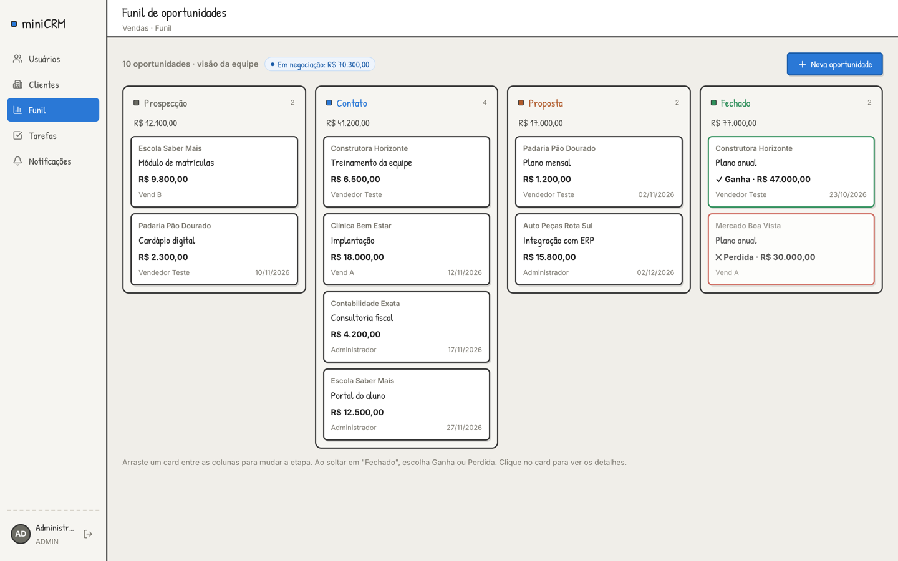
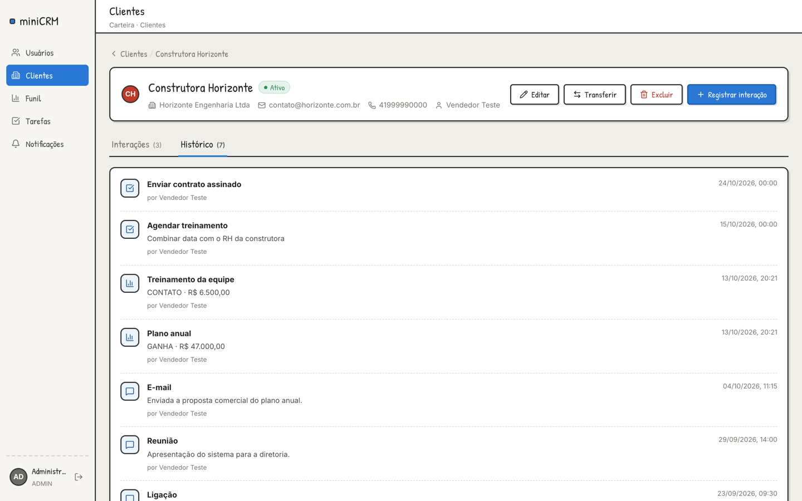
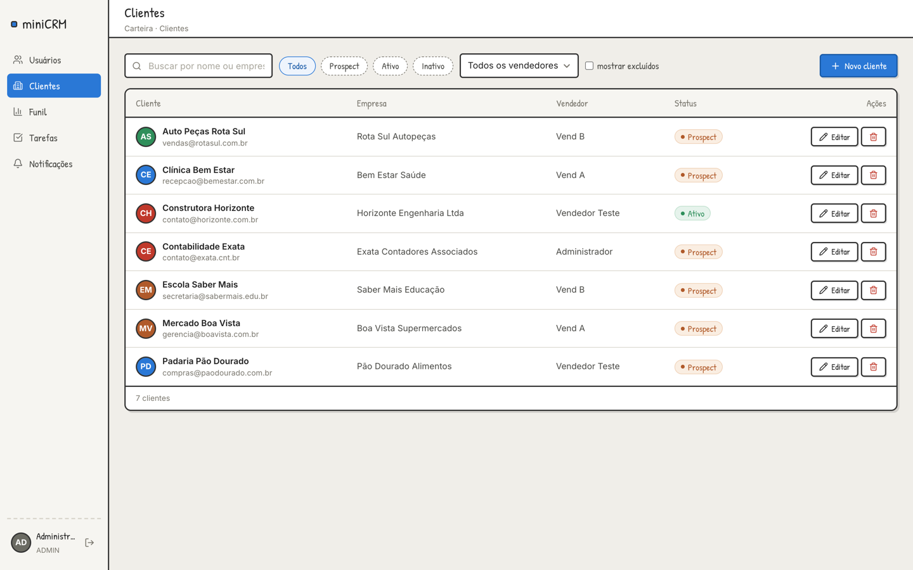
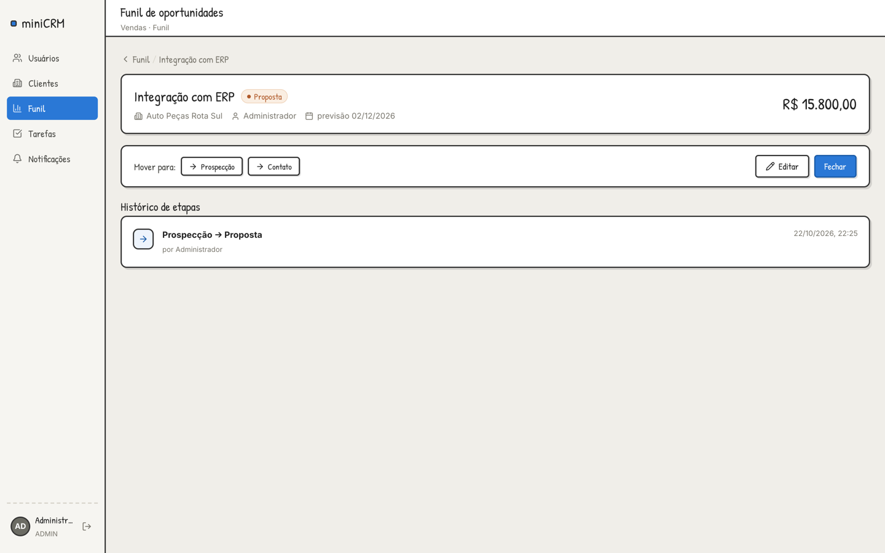
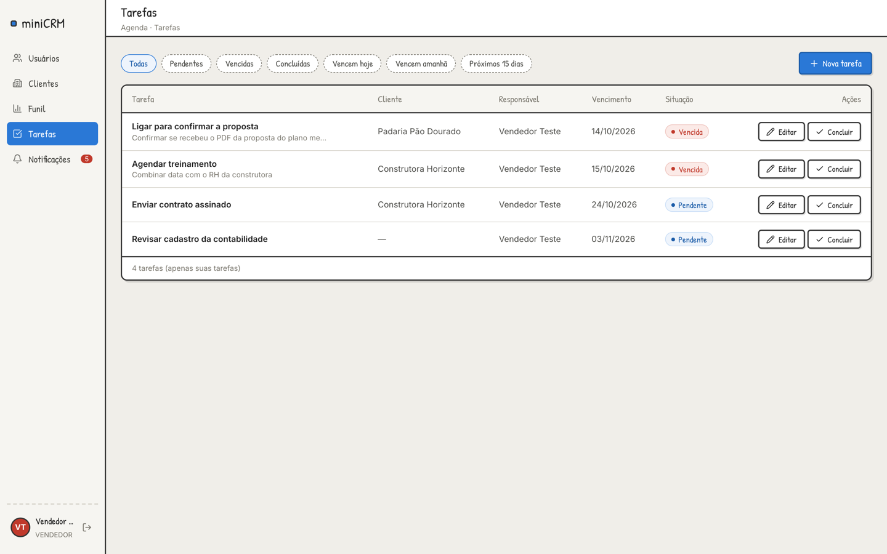
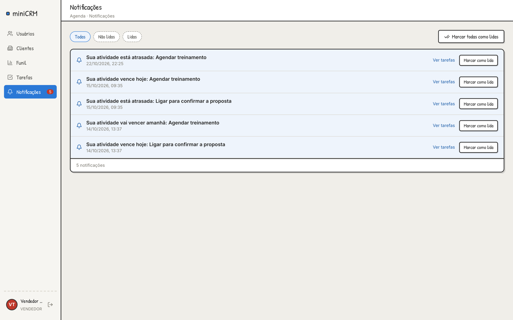
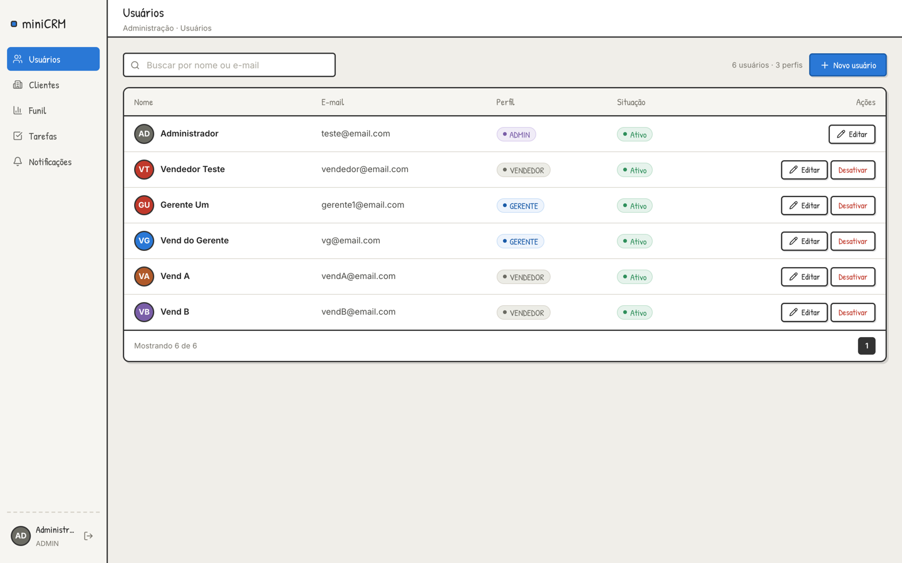
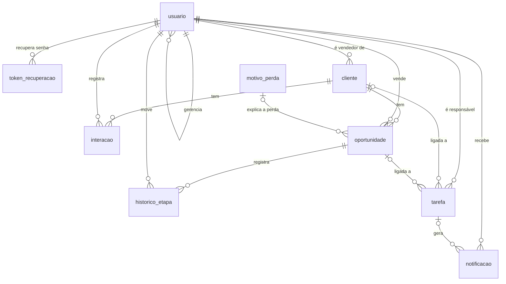

# Mini CRM

Sistema web de CRM para equipes de vendas. O vendedor cuida da própria carteira de clientes, registra contatos, acompanha as vendas num funil e recebe lembretes de tarefas. O gerente acompanha a equipe dele e o administrador controla o sistema inteiro.

API REST em **Java 21 + Spring Boot 4** e frontend em **React 19 + TypeScript**, desenvolvidos por uma equipe de 4 pessoas em módulos independentes.



## Funcionalidades

**Acesso e usuários**
- Login com token JWT, bloqueio da conta após 5 tentativas erradas e recuperação de senha por código
- Senha provisória gerada pelo sistema, com troca obrigatória no primeiro acesso
- Três perfis (administrador, gerente e vendedor) com 25 permissões por ação
- Cada usuário enxerga só a própria carteira; o gerente enxerga a equipe dele

**Clientes**
- Cadastro, busca, filtros por status e vendedor, edição, exclusão lógica e transferência de vendedor
- Registro de interações (ligação, e-mail e reunião)
- Linha do tempo do cliente com interações, oportunidades e tarefas
- Status automático: o cliente vira ATIVO quando ganha a primeira venda

**Funil de vendas**
- Kanban com arrastar e soltar entre as etapas Prospecção, Contato, Proposta e Fechado
- Fechamento como ganha ou perdida, com motivo de perda
- Histórico de cada mudança de etapa e reabertura de oportunidades fechadas

**Tarefas e notificações**
- Tarefas ligadas a clientes e oportunidades, com filtros por situação e vencimento
- Notificações automáticas quando a tarefa vence em 15 dias, amanhã, hoje ou já venceu
- Dashboard, ranking de vendedores e relatórios em CSV pela API

## Telas

| | |
|---|---|
|  |  |
| Ficha do cliente com a linha do tempo | Lista de clientes com filtros |
|  |  |
| Detalhe da oportunidade | Tarefas do vendedor |
|  |  |
| Notificações | Gestão de usuários |

## Tecnologias

| Parte | Tecnologias |
|---|---|
| Backend | Java 21, Spring Boot 4.1, Spring Security, Spring Data JPA (Hibernate), Bean Validation, Lombok, Maven |
| Autenticação | JWT (jjwt, HS256), BCrypt |
| Banco | MySQL |
| Frontend | React 19, TypeScript, Vite, React Router 7, Tailwind CSS 4, lucide-react, oxlint |
| Testes | JUnit 5, Mockito, AssertJ |

## Destaques técnicos

- **Controle de acesso por permissão, não por cargo.** Cada perfil recebe um conjunto de permissões (`Permissoes.doPerfil`) e os endpoints pedem a ação com `@PreAuthorize("hasAuthority('CLIENTE_TRANSFERIR')")`.
- **Escopo de carteira reutilizado pelos 4 módulos.** A `EscopoCarteira` calcula quais vendedores o usuário logado pode ver; registro fora do escopo responde 404.
- **Módulos que não acessam o banco uns dos outros.** A integração é feita por interfaces de consulta (`ClienteConsultaService`, `OportunidadeConsultaService`, `TarefaConsultaService`) e por eventos de domínio.
- **Eventos com consistência transacional.** Quando uma venda é ganha, o funil publica `OportunidadeFechadaEvent`, e o módulo de clientes reage com `@TransactionalEventListener(AFTER_COMMIT)` e `REQUIRES_NEW`.
- **Funil como máquina de estados.** O enum `EtapaOportunidade` define as transições permitidas de cada etapa (padrão State).
- **Busca dinâmica com a Specification API.** Filtros pequenos e combináveis, juntados com `Specification.allOf` só quando preenchidos.
- **Sem consultas escondidas.** `open-in-view` desligado e `@EntityGraph` nos finders usados pelas telas, evitando N+1 e `LazyInitializationException`.
- **API padronizada.** Paginação com um envelope genérico `PageResponse<T>` e erros sempre no mesmo formato, via `@RestControllerAdvice`.
- **Rotina de notificações.** Roda na inicialização e depois a cada 5 minutos (configurável), sem gerar notificação repetida.
- **CSV pronto para o Excel em português.** UTF-8 com BOM, separador `;` e escape conforme a RFC 4180.

## Padrões de projeto

| Padrão | Onde |
|---|---|
| Singleton | Beans do Spring, como `EscopoCarteira` e `ClienteService` |
| Template Method | `SeedBase`, `AbstractExportadorService`, `AbstractNotificacaoService` |
| Observer | `OportunidadeFechadaEvent` e `ClienteStatusListener`; `TarefaVencendoEvent` e `NotificacaoProcessador` |
| State | `EtapaOportunidade` |
| Specification | `ClienteSpecs` |
| Strategy | Escolha do exportador pelo formato no `RelatorioService` |
| Factory Method | `instanciar` nas subclasses de `AbstractNotificacaoService` |
| Facade | `DashboardService` |

## Banco de dados

As 9 tabelas são geradas pelo Hibernate a partir das entidades do pacote `model`.



## Como rodar

### Pré-requisitos

- Java 21
- Node.js 20.19 ou 22.12 (ou mais novo)
- MySQL 8

### 1. Banco

```sql
CREATE DATABASE mini_crm_db;
CREATE USER 'miniCrmUser'@'localhost' IDENTIFIED BY 'crm123P@';
GRANT ALL PRIVILEGES ON mini_crm_db.* TO 'miniCrmUser'@'localhost';
```

As tabelas são criadas na primeira execução do backend.

### 2. Backend

```bash
cd backend
./mvnw spring-boot:run
```

A API sobe em `http://localhost:8080/api/v1`. No primeiro start o sistema cria o administrador `teste@email.com` com a senha `123`, e pede a troca de senha no primeiro login.

### 3. Frontend

```bash
cd frontend
npm install
npm run dev
```

Acesse `http://localhost:5173`. O Vite repassa as chamadas de `/api` para o backend.

### Variáveis de ambiente

Todas têm valor padrão para desenvolvimento em `backend/src/main/resources/application.properties`.

| Variável | Uso |
|---|---|
| `DB_HOST`, `DB_PORT`, `DB_NAME` | Endereço do MySQL |
| `DB_USER`, `DB_PASSWORD` | Usuário do banco |
| `JWT_SECRET` | Chave de assinatura do token (mínimo de 32 caracteres) |
| `SEED_ADMIN_EMAIL`, `SEED_ADMIN_SENHA` | Administrador criado no primeiro start |

### Testes e empacotamento

```bash
cd backend
./mvnw test                                   # testes automatizados
./mvnw clean package                          # gera target/miniCRM-0.0.1-SNAPSHOT.jar
java -jar target/miniCRM-0.0.1-SNAPSHOT.jar
```

## Estrutura

```
backend/src/main/java/com/miniCRM/miniCRM
├── controller      endpoints REST
├── service         regras de negócio
├── repository      acesso ao banco (Spring Data JPA)
├── model           entidades e enums
├── dto             entrada e saída da API
├── security        JWT, permissões e escopo de carteira
├── event           eventos de domínio
├── exception       tratamento de erros
├── config          segurança, agendamento e dados iniciais
├── job             rotina de notificações
└── processamento   ouvinte que gera as notificações

frontend/src
├── pages           telas
├── components      componentes por módulo
└── api             chamadas à API
```

As especificações de cada módulo estão em [docs/specs](docs/specs/README.md).

## Equipe

| Integrante | Módulo |
|---|---|
| Pedro Costa | Autenticação, usuários e permissões ([SPEC-01](docs/specs/SPEC-01-autenticacao-usuarios-rbac.md)) |
| Lincoln Neto | Clientes e interações ([SPEC-02](docs/specs/SPEC-02-clientes-interacoes.md)) |
| Leandro Canha | Funil de oportunidades ([SPEC-03](docs/specs/SPEC-03-funil-oportunidades.md)) |
| Nicolas Hara | Tarefas, notificações, dashboard e relatórios ([SPEC-04](docs/specs/SPEC-04-tarefas-notificacoes-dashboard-relatorios.md)) |

Projeto acadêmico da disciplina Desenvolvimento Orientado a Reuso de Software.
